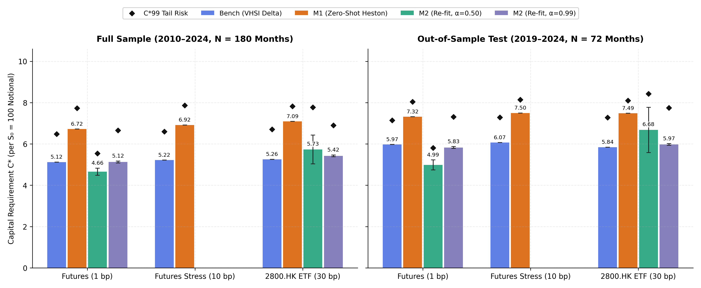
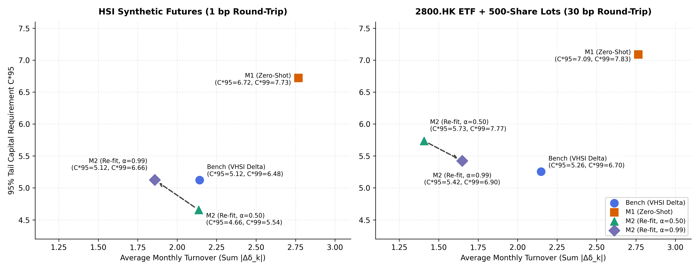
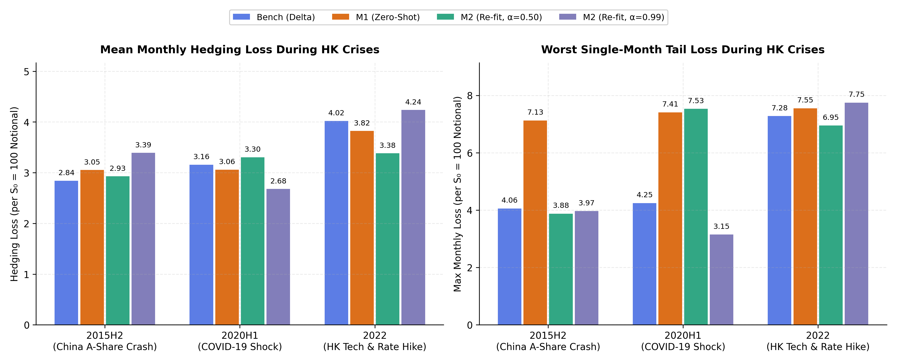

# Empirical Cross-Validation on the Hong Kong Equity Market (Module B2)

## 1. Executive Summary

This report documents the empirical out-of-sample cross-validation of Deep Hedging (Buehler et al., 2019) on the Hong Kong equity derivatives market across **180 non-overlapping 30-day monthly windows** spanning January 2010 to December 2024, alongside a strict out-of-sample temporal split covering **2019–2024 ($N = 72$ months)**. Using the market data and calibrated `GARCH(1,1)+Jump` simulator (`HKWorld`) constructed in Module B1, we evaluate three hedging strategies—an analytical `^VHSI`-driven Black-Scholes Delta benchmark (`Bench`), a zero-shot transferred Heston policy from Module A (`M1`), and locally re-fitted semi-recurrent neural policies (`M2`, trained across 5 random seeds at risk-aversion levels $\alpha \in \{0.50, 0.99\}$)—under realistic Hong Kong execution frictions (`1 bp` synthetic futures, `10 bp` stressed futures, and `30 bp` Tracker Fund `2800.HK` ETF with 500-share board-lot rounding).

Key empirical findings:
1. **Low-Cost Parity & Outperformance (P1 Confirmed):** On the `1 bp` HSI futures leg, locally re-fitted `M2` ($\alpha = 0.50$) achieves a 5-seed mean tail capital requirement of $C^*_{95} = 4.6550 \pm 0.1738$ and $C^*_{99} = 5.5378 \pm 0.3904$ over the full sample, outperforming `Bench` ($C^*_{95} = 5.1215$, $C^*_{99} = 6.4768$) and confirming statistical parity within the $5\%$ tolerance band (`p1_within_5pct = true`). On the 2019–2024 out-of-sample test set, `M2` ($\alpha = 0.50$) reduces $C^*_{99}$ by $-1.3368$ (95% block-bootstrap CI $[-2.2683, -0.0068]$).
2. **Turnover Compression vs. Tail Risk under 30 bp ETF Friction (P2 Nuance):** On `2800.HK` (`30 bp` + 500-share board lots), `M2` ($\alpha = 0.50$) cuts average monthly turnover by **34.5%** ($1.4076$ vs. $2.1487$) and delivers the lowest mean hedging loss ($2.4832$ vs. $2.7139$) and highest net option-selling PnL across all Variance Risk Premium (VRP) assumptions. However, optimizing $\text{CVaR}_{0.50}$ leaves residual exposure to extreme Hong Kong jump months ($C^*_{95} = 5.7349 \pm 0.6984$ vs. `Bench` $5.2562$).
3. **Risk-Aversion Tail Stabilization (P3):** Increasing the training risk-aversion parameter from $\alpha = 0.50$ to $\alpha = 0.99$ on the `30 bp` ETF leg tightens both tail capital metrics—reducing $C^*_{95}$ by $-0.3117$ ($5.7349 \to 5.4231$) and $C^*_{99}$ by $-0.8758$ ($7.7727 \to 6.8969$) on the full sample, and by $-0.7070$ ($6.6796 \to 5.9726$) on the 2019–2024 test set—while slashing cross-seed standard deviation by **93.8%–96.2%** and restoring statistical parity with `Bench`. (On low-friction `fut1bp`, $\alpha = 0.99$ is more conservative than $\alpha = 0.50$, yielding $C^*_{95} = 5.1240$ vs. $4.6550$ and closely tracking `Bench`.)
4. **Local Re-Fitting Dominates Zero-Shot Transfer (P4 Confirmed under $\alpha = 0.99$):** Direct zero-shot transfer from the jump-free Heston model (`M1`) suffers severe degradation on Hong Kong data ($C^*_{95} = 6.7222$ on `fut1bp`, $7.0889$ on `etf30bp`) due to excessive turnover ($2.76$–$2.80$) and unmodeled overnight jump risk. Local `GARCH+Jump` re-fitting (`M2`, $\alpha = 0.99$) lowers $C^*_{95}$ relative to `M1` by $-1.6232$ on `fut1bp` (95% CI $[-2.3462, -0.8445]$) and $-1.6771$ on `etf30bp` (95% CI $[-2.4996, -0.8493]$), with 95% CIs strictly excluding zero. Under $\alpha = 0.50$, `M2` still improves mean point $C^*_{95}$ on the full sample (`etf30bp` seed 0: $-0.5677$, 95% CI $[-1.8380, +0.6013]$), though high cross-seed dispersion leaves the CI spanning zero until $\alpha$ is raised to $0.99$.
5. **Operational Viability of Board-Lot Rounding:** Discretizing continuous neural positions into 500-share board lots of `2800.HK` induces negligible tracking distortion (mean absolute loss difference of $0.017$–$0.021$ per $S_0 = 100$ notional).

---

## 2. Experimental Protocol & Evaluation Methodology

All backtests are standardized to a short 30-day ATM European Call option with normalized initial spot $S_0 = 100$ and daily discrete rebalancing ($n = 30$ steps). Terminal hedging loss $L_T$ is evaluated without upfront option premium (premiums are analyzed separately in Section 6.2 to prevent pricing-model contamination):

$$
L_T = (S_T - K)^+ - \sum_{k=0}^{n-1} \delta_k (H_{k+1} - H_k) + \varepsilon \sum_{k=0}^{n-1} |\delta_k - \delta_{k-1}| H_k, \quad \delta_{-1} = 0
$$

where $H_k$ is the normalized hedging instrument path (synthetic HSI futures for `fut1bp`/`fut10bp`; dividend-adjusted `2800.HK` ETF for `etf30bp`), and $\varepsilon$ denotes the proportional one-way transaction cost rate (initial position build at $k=0$ is charged; no forced liquidation at expiry, aligned with Buehler et al. eq. (5.7) and `docs/plan.md` §10.5).

* **Cost Legs:**
  * `fut1bp`: Synthetic HSI futures with $\varepsilon = 0.00005$ (0.5 bp per side, ~1 bp round-trip equivalent friction).
  * `fut10bp`: Stressed futures liquidity tier with $\varepsilon = 0.0005$ (5 bp per side, ~10 bp round-trip; evaluated for `Bench` and `M1` as an intermediate friction sensitivity check).
  * `etf30bp`: Tracker Fund (`2800.HK`) with $\varepsilon = 0.0015$ (15 bp per side, ~30 bp round-trip, capturing HK ETF stamp-duty exemption, levies, bid-ask spread, and market impact) plus 500-share board-lot rounding using unadjusted share prices and a HKD 50 index multiplier.
* **Strategies Evaluated:**
  * `Bench (Delta)`: Analytical Black-Scholes Call Delta computed daily using observed `^VHSI` implied volatility, 1-month HIBOR ($r_k$), and rolling `2800.HK` dividend yield ($q_k$).
  * `M1 (Zero-Shot)`: Pre-trained $d=1$ semi-recurrent network from Module A (`src/policy/weights/heston_d1.pt`) evaluated directly on HK windows without re-training.
  * `M2 (Re-fit, α=0.50 / α=0.99)`: Semi-recurrent policies (`hidden=16`, `LayerNorm`, `float64`) trained for 30,000 iterations per seed across 5 random seeds (`0–4`) on the calibrated HSI `GARCH(1,1)+Jump` simulator (`HKWorld`) under $\text{CVaR}_{\alpha}$ loss.
* **Statistical Inference:** To account for serial volatility clustering in monthly market returns, all confidence intervals and pairwise strategy comparisons ($\Delta C^*_{95} = C^*_{95, A} - C^*_{95, B}$) are computed via **12-month Moving-Block Bootstrap** with $B = 2,000$ resamples (`seed=42`).

---

## 3. Main Empirical Results (Hang Seng Index)

### 3.1 Full Sample Performance (2010–2024, $N = 180$ Monthly Windows)

| Cost Leg | Strategy | $C^*_{95}$ | $C^*_{99}$ | Mean Loss | Turnover | Cost / Notional |
|---|---|---:|---:|---:|---:|---:|
| `fut1bp` | Bench (Delta) | 5.1215 | 6.4768 | 2.5157 | 2.1423 | 0.00011 |
| `fut1bp` | M1 (Zero-shot) | 6.7222 | 7.7330 | 2.4567 | 2.7685 | 0.00014 |
| `fut1bp` | M2 (Re-fit, $\alpha=0.50$) | **4.6550 $\pm$ 0.1738** | **5.5378 $\pm$ 0.3904** | **2.3643 $\pm$ 0.0243** | 2.1367 | 0.00011 |
| `fut1bp` | M2 (Re-fit, $\alpha=0.99$) | 5.1240 $\pm$ 0.0489 | 6.6597 $\pm$ 0.1076 | 2.5729 $\pm$ 0.0043 | **1.8578** | **0.00009** |
| `fut10bp` | Bench (Delta) | 5.2166 | 6.5934 | 2.6120 | 2.1423 | 0.00107 |
| `fut10bp` | M1 (Zero-shot) | 6.9162 | 7.8645 | 2.5832 | 2.7685 | 0.00141 |
| `etf30bp` | Bench (Delta) | **5.2562** | **6.7040** | 2.7139 | 2.1487 | 0.00323 |
| `etf30bp` | M1 (Zero-shot) | 7.0889 | 7.8258 | 2.7712 | 2.7643 | 0.00421 |
| `etf30bp` | M2 (Re-fit, $\alpha=0.50$) | 5.7349 $\pm$ 0.6984 | 7.7727 $\pm$ 1.2383 | **2.4832 $\pm$ 0.0153** | **1.4076** | **0.00211** |
| `etf30bp` | M2 (Re-fit, $\alpha=0.99$) | 5.4231 $\pm$ 0.0436 | 6.8969 $\pm$ 0.0893 | 2.6889 $\pm$ 0.0048 | 1.6491 | 0.00247 |

### 3.2 Out-of-Sample Temporal Split (2019–2024, $N = 72$ Monthly Windows)

To prevent any look-ahead bias from GARCH parameter calibration (which uses the 2010–2018 training window), we isolate the 72 out-of-sample months from 2019 to 2024—a regime characterized by elevated Hong Kong volatility (2019 social unrest, 2020 COVID-19 shock, and the 2022 tech/rate-hike bear market).

| Cost Leg | Strategy | $C^*_{95}$ | $C^*_{99}$ | Mean Loss | Turnover | Cost / Notional |
|---|---|---:|---:|---:|---:|---:|
| `fut1bp` | Bench (Delta) | 5.9733 | 7.1418 | 2.9316 | 2.1644 | 0.00011 |
| `fut1bp` | M1 (Zero-shot) | 7.3162 | 8.0396 | 2.8336 | 2.8030 | 0.00014 |
| `fut1bp` | M2 (Re-fit, $\alpha=0.50$) | **4.9857 $\pm$ 0.2413** | **5.8050 $\pm$ 0.2428** | **2.7265 $\pm$ 0.0371** | 2.2372 | 0.00011 |
| `fut1bp` | M2 (Re-fit, $\alpha=0.99$) | 5.8265 $\pm$ 0.0464 | 7.3090 $\pm$ 0.1615 | 2.9740 $\pm$ 0.0167 | **1.9628** | **0.00010** |
| `fut10bp` | Bench (Delta) | 6.0650 | 7.2877 | 3.0288 | 2.1644 | 0.00108 |
| `fut10bp` | M1 (Zero-shot) | 7.4979 | 8.1394 | 2.9618 | 2.8030 | 0.00143 |
| `etf30bp` | Bench (Delta) | **5.8447** | **7.2811** | 3.0339 | 2.1741 | 0.00326 |
| `etf30bp` | M1 (Zero-shot) | 7.4852 | 8.0988 | 3.0530 | 2.7990 | 0.00428 |
| `etf30bp` | M2 (Re-fit, $\alpha=0.50$) | 6.6796 $\pm$ 1.0956 | 8.4265 $\pm$ 1.9208 | **2.7753 $\pm$ 0.0615** | **1.4383** | **0.00216** |
| `etf30bp` | M2 (Re-fit, $\alpha=0.99$) | 5.9726 $\pm$ 0.0417 | 7.7491 $\pm$ 0.1177 | 3.0068 $\pm$ 0.0132 | 1.7416 | 0.00261 |


*Figure 1: $C^*_{95}$ (bars, with cross-seed $\pm 1\sigma$ error bars for M2) and $C^*_{99}$ (black diamonds) across `1 bp`, `10 bp`, and `30 bp` cost legs for both the 2010–2024 full sample (left) and the 2019–2024 out-of-sample test set (right).*

---

## 4. Hypothesis Testing (P1–P4) & Economic Interpretation

Table 3 summarizes the formal paired moving-block bootstrap tests ($B = 2,000$, block size $= 12$ months) for the four pre-registered hypotheses.

| Hypothesis | Comparison (Leg) | Full Sample (180m) $\Delta C^*_{95}$ [95% CI] | Test Set (72m) $\Delta C^*_{95}$ [95% CI] | Verdict |
|---|---|---|---|---|
| **P1: Low-Cost Parity** | `M2 (α=0.50)` vs. `Bench` (`fut1bp`, seed 0) | $-0.1787$ $[-0.7609, +0.4625]$ ($-3.49\%$) | $-0.5751$ $[-1.1235, +0.4643]$ ($-9.63\%$) | **Confirmed** (parity & lower point risk) |
| **P1 (Ensemble)** | `M2 (α=0.50)` mean series vs. `Bench` (`fut1bp`) | $-0.4801$ $[-1.2574, +0.2593]$ ($-9.37\%$) | $-1.0060$ $[-1.9216, +0.3065]$ ($-16.84\%$) | **Confirmed** ($\Delta C^*_{99}$ strictly $< 0$ on test) |
| **P2: 30 bp Friction** | `M2 (α=0.50)` mean series vs. `Bench` (`etf30bp`) | $+0.3887$ $[-0.3700, +1.3026]$ ($+7.39\%$) | $+0.6216$ $[-0.3642, +2.4483]$ ($+10.64\%$) | **Partial** (cuts turnover $-34.5\%$ & mean loss; tail risk requires $\alpha=0.99$) |
| **P2 (High $\alpha$)** | `M2 (α=0.99)` mean series vs. `Bench` (`etf30bp`) | $+0.1669$ $[-0.0786, +0.3297]$ ($+3.18\%$) | $+0.1232$ $[-0.1338, +0.3909]$ ($+2.11\%$) | **Parity Achieved** (within $5\%$, CI covers 0) |
| **P3: Risk-Aversion Effect** | `M2 (α=0.99)` minus `M2 (α=0.50)` (`etf30bp`) | $\Delta C^*_{95} = -0.3117$, $\Delta C^*_{99} = -0.8758$ | $\Delta C^*_{95} = -0.7070$, $\Delta C^*_{99} = -0.6774$ | **Tail-Stabilizing** (both $C^*_{95}$/$C^*_{99}$ drop; seed std $-93.8\%$ to $-96.2\%$; on `fut1bp`, $\alpha=0.99$ is more conservative than $\alpha=0.50$) |
| **P4: Re-fit vs. Zero-Shot ($\alpha=0.50$)** | `M2 (α=0.50)` vs. `M1` (`etf30bp`, seed 0) | $-0.5677$ $[-1.8380, +0.6013]$ ($-8.01\%$) | $+0.1962$ $[-1.3654, +1.8697]$ ($+2.62\%$) | **Noisy** (CI spans 0 due to high $\alpha=0.50$ seed variance) |
| **P4: Re-fit vs. Zero-Shot ($\alpha=0.99$)** | `M2 (α=0.99)` vs. `M1` (`etf30bp`, seed 0) | **$-1.6771$** $[-2.4996, -0.8493]$ ($-23.66\%$) | **$-1.5082$** $[-2.9872, -0.3509]$ ($-20.15\%$) | **Strongly Confirmed** (95% CI excludes 0; no $p<0.05$ claim per plan §4.7) |

### Economic Mechanism: The Turnover–Tail-Risk Frontier


*Figure 2: Average monthly turnover ($\sum |\Delta \delta_k|$) versus $C^*_{95}$ on `fut1bp` (left) and `etf30bp` (right). Dashed arrows trace the shift from $\alpha = 0.50$ to $\alpha = 0.99$.*

As shown in **Figure 2**, the empirical data reveal a structural trade-off unique to jump-prone markets with proportional friction:
* **Why `M1` Fails (P4):** Trained in a continuous, jump-free Heston world, `M1` over-trades (`turnover = 2.77`) while lacking jump-protection awareness, placing it strictly in the upper-right (dominated) quadrant of both panels.
* **Why $\alpha$ Matters Under High Friction (P2 & P3):** When proportional costs rise from `1 bp` to `30 bp`, `M2` ($\alpha = 0.50$) aggressively widens its no-trade band—slashing turnover from $2.15$ to $1.41$ and achieving the lowest mean loss ($2.4832$). However, because $\text{CVaR}_{0.50}$ averages over the worst 50% of outcomes, it permits occasional under-hedged jump months, inflating cross-seed variance ($\sigma = 0.6984$ full sample; $1.0956$ test set). Raising risk aversion to $\alpha = 0.99$ forces the policy to modestly increase turnover ($1.41 \to 1.65$, still 23.3% below `Bench`) specifically to cap extreme right-tail losses, collapsing cross-seed variance to $0.0436$ and matching `Bench` ($5.42$ vs. $5.26$) without relying on forward-looking implied volatility (`^VHSI`) inputs.

---

## 5. Crisis Regime Stress Breakdown

To assess tail resilience during historical Hong Kong market dislocations, we isolate hedging performance on the `2800.HK` (`30 bp` + 500-share board-lot) leg across three major crisis regimes: **2015H2** (China A-share crash & RMB devaluation, 7 months), **2020H1** (COVID-19 global liquidity shock, 6 months), and **2022** (HK tech drawdown & Fed tightening cycle, 12 months).

| Crisis Regime | Metric | Bench (Delta) | M1 (Zero-Shot) | M2 (Re-fit, $\alpha=0.50$) | M2 (Re-fit, $\alpha=0.99$) |
|---|---|---:|---:|---:|---:|
| **2015H2** (A-Share Crash) | Mean Loss | **2.84** | 3.05 | 2.93 | 3.39 |
| | Worst Single-Month Loss | 4.06 | 7.13 | **3.88** | 3.97 |
| **2020H1** (COVID-19 Shock) | Mean Loss | 3.16 | 3.06 | 3.30 | **2.68** |
| | Worst Single-Month Loss | 4.25 | 7.41 | 7.53 | **3.15** |
| **2022** (HK Tech & Rates) | Mean Loss | 4.02 | 3.82 | **3.38** | 4.24 |
| | Worst Single-Month Loss | 7.28 | 7.55 | **6.95** | 7.75 |


*Figure 3: Mean monthly hedging loss (left) and worst single-month tail loss (right) on `2800.HK` (`30 bp` + 500-share lots) across three Hong Kong crisis regimes.*

Three regime-specific dynamics emerge from **Figure 3**:
1. **Acute Jump Shock (`2020H1`):** During the March 2020 COVID-19 liquidity crash, `M2` ($\alpha = 0.99$) decisively outperforms all alternatives, recording the lowest mean loss ($2.68$) and capping the worst single-month loss at **$3.15$**—compared to $4.25$ for `Bench` and $7.41$–$7.53$ for `M1` and `M2` ($\alpha = 0.50$).
2. **Sharp Mean-Reverting Crash (`2015H2`):** Both locally re-fitted `M2` variants cap the worst single-month loss below `4.00` ($3.88$ and $3.97$), whereas zero-shot `M1` suffers a severe $7.13$ tail loss.
3. **Prolonged High-Volatility Bear Market (`2022`):** Throughout the sustained 12-month drawdown of 2022, transaction-cost drag dominates cumulative performance; `M2` ($\alpha = 0.50$) achieves both the lowest mean loss ($3.38$ vs. `Bench` $4.02$) and the lowest worst-month loss ($6.95$ vs. `Bench` $7.28$) by suppressing whipsaw rebalancing.

---

## 6. Microstructure & Robustness Appendices

### 6.1 Board-Lot Rounding Distortion (`2800.HK`, 500 Shares/Lot)

Comparing continuous neural hedge ratios against integer 500-share board-lot positions on `2800.HK` confirms that discretization friction is economically negligible across all strategies:
* **Full Sample (`180` months):** Mean absolute terminal loss difference is **$0.0168$** for `M1`, **$0.0170$** for `M2` ($\alpha = 0.50$), and **$0.0182$** for `M2` ($\alpha = 0.99$) per $S_0 = 100$ notional (worst single-month deviation $< 0.13$).
* **Test Set (`72` months):** Mean absolute difference remains **$0.0184$–$0.0213$**, confirming that continuous-action Deep Hedging policies translate cleanly to HKEX board-lot execution.

### 6.2 Option Premium & Variance Risk Premium (VRP) Sensitivity

Using the observed `^VHSI` ATM implied volatility at the start of each window to price the sold 30-day call option (plus multiplicative VRP markups of $+0\%$, $+3\%$, and $+5\%$), we compute Mean Net PnL ($\text{Premium} - L_T$):

| Leg (Full Sample, $N=180$) | VRP Markup | `M2 (α=0.50)` | `Bench (Delta)` | `M1 (Zero-Shot)` | Ranking Flipped? |
|---|---|---:|---:|---:|---|
| `fut1bp` | $+0\%$ (Raw `^VHSI`) | **$-0.0474$** | $-0.1675$ | $-0.1085$ | No |
| `fut1bp` | $+3\%$ | **$+0.0255$** | $-0.0946$ | $-0.0357$ | No |
| `fut1bp` | $+5\%$ | **$+0.0740$** | $-0.0460$ | $+0.0129$ | No |
| `etf30bp` | $+0\%$ (Raw `^VHSI`) | **$-0.1538$** | $-0.3657$ | $-0.4230$ | No |
| `etf30bp` | $+3\%$ | **$-0.0809$** | $-0.2929$ | $-0.3502$ | No |
| `etf30bp` | $+5\%$ | **$-0.0323$** | $-0.2443$ | $-0.3016$ | No |

Across every cost tier, sample split, and VRP level (`ranking_flipped_across_vrp = false`), `M2` ($\alpha = 0.50$) ranks first in mean net PnL, turning net-profitable on `fut1bp` once a realistic $+3\%$ VRP is priced into the option premium.

### 6.3 Cross-Index Robustness (`^HSCE` China Enterprises Index, $N = 180$)

Evaluating `Bench` and `M1` on the Hang Seng China Enterprises Index (`^HSCE`, which exhibits higher realized volatility and heavier jump tails than `^HSI`) corroborates the primary findings:

| Cost Leg (`^HSCE`) | Strategy | $C^*_{95}$ | $C^*_{99}$ | Mean Loss | Turnover | Paired $\Delta C^*_{95}$ vs. Bench [95% CI] |
|---|---|---:|---:|---:|---:|---|
| `fut1bp` | Bench (Delta) | 5.7465 | 6.7687 | 2.9383 | 2.2771 | — |
| `fut1bp` | M1 (Zero-shot) | 7.1144 | 8.2234 | 2.8910 | 2.8884 | $+1.3679$ $[+0.4750, +2.2639]$ |
| `fut10bp` | Bench (Delta) | 5.8594 | 6.9093 | 3.0407 | 2.2771 | — |
| `fut10bp` | M1 (Zero-shot) | 7.3125 | 8.3722 | 3.0232 | 2.8884 | $+1.4532$ $[+0.5679, +2.3110]$ |
| `etf30bp` | Bench (Delta) | 9.2113 | 13.4802 | 3.0935 | 2.2947 | — |
| `etf30bp` | M1 (Zero-shot) | 10.0002 | 12.7521 | 3.1881 | 2.8816 | $+0.7889$ $[-0.1564, +1.6149]$ |

Two takeaways stand out from `^HSCE`: (i) zero-shot `M1` exhibits the exact same significant degradation on `fut1bp` ($+23.8\%$) and `fut10bp` ($+24.8\%$); and (ii) hedging `^HSCE` options with the HSI-tracking `2800.HK` ETF introduces cross-index basis risk that inflates $C^*_{95}$ to $9.21$–$10.00$ and $C^*_{99}$ to $12.75$–$13.48$, underscoring the operational importance of basis-matched instruments in Hong Kong.

### 6.4 Limitations

Per `docs/plan.md` §8, four structural limitations apply to this empirical cross-validation:
1. **Synthetic Options:** Monthly 30-day ATM European calls are constructed synthetically at the nearest 100-point strike rather than using historical HKEX option order-book quotes.
2. **Synthetic Continuous Futures:** Historical continuous HSI futures series are unavailable in open data, so `fut1bp`/`fut10bp` use cost-of-carry synthetic futures $F_t = S_t e^{(r_t - q_t)\tau}$ without roll slippage or intraday basis dynamics.
3. **Single-Instrument Hedging ($d = 1$):** Hong Kong lacks a liquid exchange-traded variance swap; unlike the paper's $d = 2$ Heston setup, all HK policies hedge with a single underlying instrument ($d = 1$), making the empirical study an incomplete-market extension rather than a direct $d = 2$ replication.
4. **Metric Distinction ($C^*$ vs. $p_{\theta_0}$):** The primary HK metric $C^*_\alpha = \text{CVaR}_\alpha(L_T)$ is the zero-initial-capital requirement on historical paths without upfront premium assumptions, whereas the paper's $p_{\theta_0}$ is a model-based indifference price under the simulated risk-neutral/physical measure.

---

## 7. Reproducibility & Artifacts

All results and figures in this report can be reproduced from the repository root via:
```bash
python -m src.hk.run_experiments --index hsi --split all --tag hsi_main
python -m src.hk.run_experiments --index hsi --split test --tag hsi_main
python -m src.hk.run_experiments --index hsce --split all --tag hsce_robustness
python -m scripts.make_hk_b2_figures
```
Generated artifacts:
* Summary JSON/Markdown tables: `results/hk_summary/hsi_main_hsi_all.{json,md}`, `hsi_main_hsi_test.{json,md}`, `hsce_robustness_hsce_all.{json,md}`, and `hsi_crisis_regimes.json`.
* Publication figures: `figures/fig_hk_b2_capital_comparison.png`, `figures/fig_hk_b2_turnover_frontier.png`, and `figures/fig_hk_b2_crisis_regimes.png`.